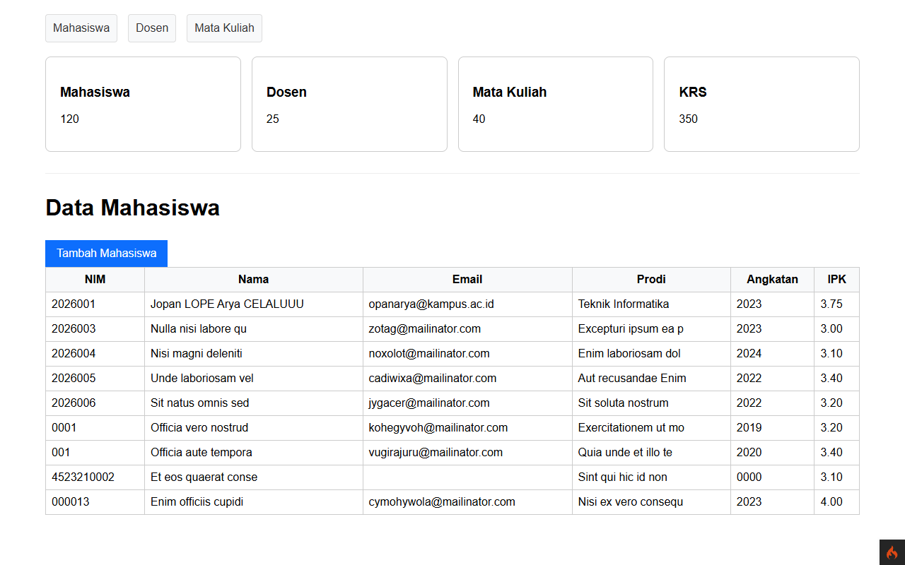
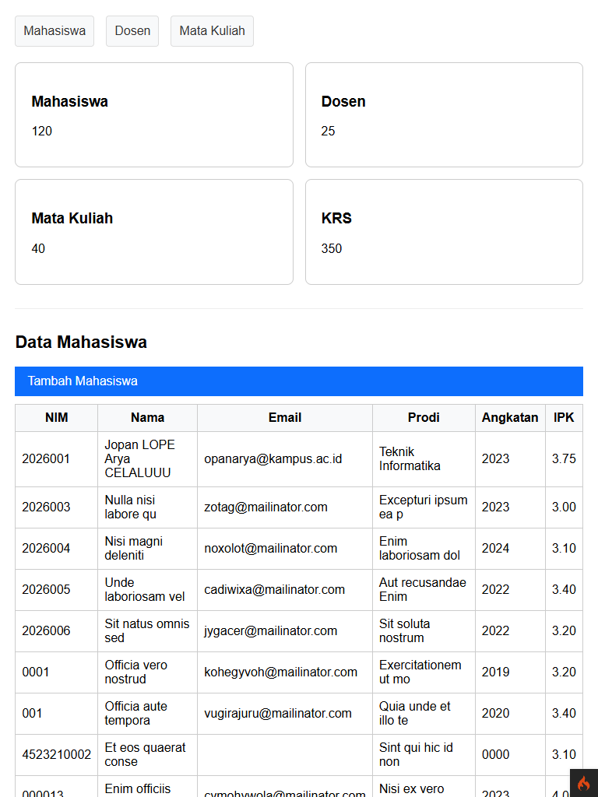
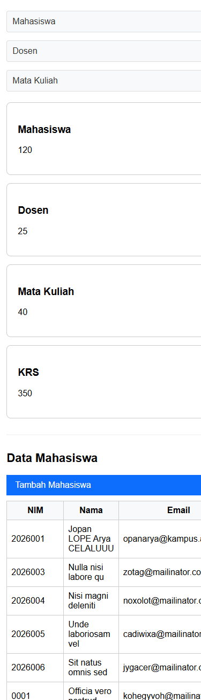

# Studi Kasus Praktikum PBW Pertemuan 9: Desain Responsif 

Anggota Kelompok:

Riziq Wijaya - 4524210091  
Shandika Aldino Gunawan - 452421097  
Fatih Miftahul Rizky - 4524210107  

Aplikasi sistem akademik sederhana berbasis CodeIgniter 4 yang menerapkan konsep Responsive Web Design menggunakan CSS Media Queries, CSS Grid, dan Flexbox.

## Visualisasi Tampilan Responsif

Berikut perbandingan tampilan aplikasi pada tiga resolusi perangkat yang berbeda:

### 1. Tampilan Desktop (Resolusi &ge; 1000px)
- **Menu Navigasi**: Berjajar horizontal dengan jarak renggang (`gap: 15px`).
- **Kartu Statistik / Dashboard**: Memakai CSS Grid 4 kolom sejajar (`grid-template-columns: repeat(4, 1fr)`).
- **Tombol Aksi**: Berukuran proporsional (`inline-block`).
- **Tabel Data**: Terbuka penuh menyesuaikan lebar kontainer layar lebar (90% width).

---

### 2. Tampilan Tablet (Resolusi 600px – 999px)
- **Menu Navigasi**: Tetap berada dalam posisi horizontal.
- **Kartu Statistik / Dashboard**: Berubah otomatis menjadi 2 kolom (`grid-template-columns: repeat(2, 1fr)`).
- **Tombol Aksi**: Berubah menjadi selebar layar (`display: block; width: 100%`) agar lebih mudah disentuh (touch-friendly).
- **Tabel Data**: Terbungkus dalam kontainer `overflow-x: auto` sehingga tetap rapi jika lebar layar terbatas.

---

### 3. Tampilan Smartphone / Mobile (Resolusi < 600px)
- **Menu Navigasi**: Berubah arah menjadi susunan vertikal ke bawah (`flex-direction: column`).
- **Kartu Statistik / Dashboard**: Berubah menjadi 1 kolom penuh per kartu (`grid-template-columns: 1fr`).
- **Tombol Aksi**: Memenuhi lebar layar untuk kemudahan klik di layar sentuh kecil.
- **Tabel Data**: Dilengkapi scroll horizontal (`overflow-x: auto`), mencegah tabel terpotong atau merusak struktur halaman.

---

## Rincian Breakpoint CSS

File CSS utama berada di `public/css/style.css`:

| Breakpoint | Elemen yang Berubah | Aturan CSS |
|---|---|---|
| `min-width: 1000px` | Kartu Statistik | `grid-template-columns: repeat(4, 1fr);` |
| `min-width: 600px` | Kartu Statistik | `grid-template-columns: repeat(2, 1fr);` |
| `max-width: 768px` | Container, Judul, & Tombol | Container 95%, font judul 22px, tombol `width: 100%` |
| `max-width: 600px` | Menu Navigasi & Statistik | `flex-direction: column;` (tampilan 1 kolom vertikal) |
